# Qwen3-Next-80B-A3B decode 阶段 HBM 访存 Trace 采集与分析总结（v5）

> 本文是对 v5 阶段全部工作的汇总：采集背景与目标、基于 v5 数据的存储/访存特性分析、单层算子与 kernel 的访存映射、decode/prefill 推理流程、MoE 专家激活规律（预取可行性研究），以及"如何把 trace 特性转化为 FPGA 硬件仿真平台输入"的落地方案。文中图片均随本文件存放在同目录。

---

## 1. 前言与目标

### 1.1 背景
我们要为一个 **FPGA 硬件仿真平台**（Host FPGA → HBM FPGA，用 MB 级 SRAM 模拟 HBM）提供**真实工作负载的访存激励**，用于研究大模型 decode 阶段的 HBM 行为（带宽、延迟、bank/row 冲突）以及预取/双缓冲等"计算-IO 掩盖"策略。

FPGA 的 SRAM 只有 MB 级，而模型的 HBM 地址空间是 80GB 级，**不可能把真实 trace 直接作为输入源**。因此需要：**采集真实 decode 阶段的 HBM 访存 trace → 分析其特性规律 → 抽象为"访存特性指纹" → 生成适配 FPGA 的激励**。

### 1.2 采集对象与方法
- **模型**：Qwen3-Next-80B-A3B-Instruct（NVFP4 量化），48 层，MoE（每层 512 个 routed 专家、每 token 激活 top-10）+ 每层一个 shared expert；**混合注意力**：每 4 层中 3 层为线性注意力(GDN)、1 层为全注意力（全注意力在 L3/7/…/47，共 12 层）。
- **硬件/软件**：RTX 6000D（sm_120, Blackwell, 96GB），CUDA 13.0，vLLM 0.33（`enforce_eager=True`，batch=1）。
- **采集工具**：基于 NVBit 1.8.1 自研 `hbm_trace`，同时抓两类通道：
  - **普通 LD/ST（LDG/STG 等）**：线程级访存，记录 `grid, cta, warp, opcode, addr, size, layer_id`；
  - **TMA（Tensor Memory Accelerator）**：CUTLASS 用 `cp.async.bulk.tensor`（SASS `UTMALDG/UTMASTG`）批量搬权重/激活，逐 tile 记录 `start, span, n_elems, layer_id`（方案A：起点+跨度+元素数）。
- **相位标记**：Python 侧在每层 forward 前打 marker，记录 `layer_id`（100=embedding，0–47=层，200=output/lm_head）。
- **采集范围**：**只采集 decode**（`seq_len==1` 才开启 tracing）。3 个不同 prompt（代码 / 数学 / 中文闲聊），各 19 个 decode token，共 **57 个 token**（经 grid_launch 跳变确认边界为 19/19/19）。
- **allocator 地图**：与 trace **同一次运行**内 dump，记录每个权重张量的 `名字/地址/大小` 与 KV/状态池区间，用于把地址映射到"数据类型/所属层"。

### 1.3 说明与局限
- 本文数据基于 v5（一次采集，尾部因工具超时被杀，TMA 尾部有极少量未 flush）。
- **未采集 prefill**（prefill 为计算密集型、访存特性与 decode 不同，见 §2.3）。
- trace **无时间戳**（记录只有 grid/cta/warp/地址/大小/layer），精确到达时序需后续补采。

---

## 2. 模型推理流程与 trace 的对应

### 2.1 模型结构要点（与 HBM 相关）
- **MoE（主体）**：每层 512 个 routed 专家，每个专家是一组**权重张量**（gate+up=`w13_weight`、down=`w2_weight`、以及 NVFP4 量化 scale），单专家合计约 **1.77MB**；此外每层一个 shared expert（稠密小 FFN）。
- **注意力**：3/4 层为 GDN 线性注意力（`in_proj_qkvz / conv1d / out_proj / A_log / dt_bias / norm`），1/4 层为全注意力（qkv/o + KV cache）。GDN 用**固定递推状态**，全注意力用**随上下文增长的 KV cache**。
- **每层还有** RMSNorm（input / post-attention）与 MoE 路由门控 `mlp.gate`。

### 2.2 decode 阶段流程（与 trace 的相位/记录对应）
decode 是自回归循环：**每一步只处理 1 个新 token，但每层都要与缓存里全部历史 token 的 K/V 做注意力**。

一个 decode step（token 输入 → 下一个 token）：
1. Embedding：token id → hidden；
2. 逐层 l=0..47：
   - `input_layernorm` → 注意力块（GDN 或全注意力）：用该层权重投影出 Q/K/V，新 K/V 入缓存，Q 与全部历史 K/V 做注意力 → out_proj → 残差；
   - `post_attention_layernorm` → MoE：router 对 512 专家打分 → **top-10**，选中专家 + shared expert 计算 FFN → 残差；
3. L47 之后：`final norm → lm_head → logits → 采样`，得到下一个 token。

**与 trace 的对应**：每个 decode token 对应一段 `100(emb) → L0..47 → 200(out)` 的记录序列；`layer_id` 直接给出记录所属层/相位。图 `v5_layers_aligned_clean.png` 正是把"每层访问了哪些权重地址"画成热图（见 §5.3）。

### 2.3 prefill 阶段流程（无 trace，作为对照）
prefill 把**整段 prompt 的 N 个 token 一次并行**过 48 层：
- 注意力为 `N×N` 的**因果自注意力**（token i 只能看到 j≤i），Q/K/V 均为 N 行；
- 每层把 N 个 prompt token 的 K/V **一次性写满** KV cache；
- 第 47 层后得到 `logits (N×V)`，**只用最后一个位置的 logits** 采样出第一个生成 token（token0）；其余位置的 logits 在生成时不用（训练时才是监督目标）。

**decode 与 prefill 的区别**：

| | prefill | decode |
|---|---|---|
| 输入 | N token 一起 | 1 token |
| 注意力 | N×(cache+N)，含 N×N 因果块 | 1×(cache+1) |
| 瓶颈 | 计算密集（大 GEMM） | 访存密集（重读权重、读长 KV） |
| KV | 批量写入 | 每步追加 1 个 |
| 本次是否采集 | **否** | **是** |

> 若 FPGA 也需评估 prefill，需单独采集 prefill trace。

---

## 3. 数据概况与清洗

### 3.1 数据规模
- 普通 LD/ST：**约 41.87 亿条**记录（32B/条）；
- TMA：**2986 万条**传输记录（40B/条）；
- allocator 地图：权重 **47.42GB** + KV/状态池 **25GB** 的精确区间。

### 3.2 token 与 prompt 划分
- 共 57 个 decode token；通过 `grid_launch_id` 在 token 之间的小跳变（+15）确认 prompt 边界为 **19/19/19**（prompt1=0–18，prompt2=19–37，prompt3=38–56）。

### 3.3 数据清洗（消除"假跨层"）
分析中发现：TMA 地址解析在 **L47 的约 280 个 grouped-GEMM grid** 上解析出"均匀撒到所有层、每层等量"的假地址（另有少量 regular 记录同样现象）。由于"一个层的 kernel 读到别的层权重"在物理上不应发生（且已多角度验证真实跨层≈0），故将这些"record 层 L 却访问到别层权重地址"的记录判为**解析假象并剔除**：
- 仅影响 **L47**（regular 剔除约 937 万条，TMA 剔除约 70.9 亿元素），L0–L46 不受影响。

### 3.4 正确的绘图方法（消除拖尾/多色）
旧图"拖尾/一根条多色"的根因是**粗分桶跨张量边界 + 单色赋值 + 插值**。v5 后期统一改为：
- **逐记录精确归属**（每条地址二分到唯一张量）；
- **纵轴按张量边界对齐**（每行只属于唯一张量，绝不跨张量合并；小张量至少 1 行）；
- **不插值**、按数据类型分类上色、纯白底。
这样从构造上杜绝"一行被多层点亮"。详见 §5.3 与 §7。

---

## 4. HBM 存储特性（数据类型占比与地址布局）

### 4.1 整体存储占比
按地址长度统计（0~86GB）：

| 区域 | 地址占比 | 说明 |
|---|---|---|
| MoE 专家 | 50.2% | 43.5GB，权重主体 |
| KV/状态 | 28.8% | 25.0GB 池 |
| 空洞/未分配 | 16.5% | 对齐空隙 + 1.48GB 大洞，运行时作 workspace |
| attention 权重 | 2.9% | 2.5GB |
| embedding | 0.7% | 0.62GB |
| lm_head | 0.7% | 0.62GB |
| 其他权重 | 0.1% | norm / 路由门控等 |

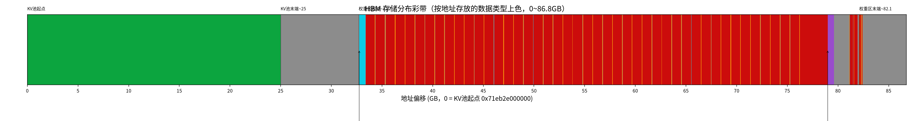

*图 4-1：一维存储彩带（按地址存放的数据类型上色）。*

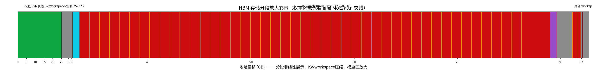

*图 4-2：分段非线性放大——KV/workspace 压缩，权重区放大以看清各层 MoE/attn 的交错。*

### 4.2 每层 MoE 的内部布局（单层 ≈906MB）
以中间层为例，每层 routed experts 由 **4 个大张量**连续排布（合计 ≈906MB）：

| 相对该层 MoE 块起点 | 大小 | 张量 | 每专家步长 |
|---|---|---|---|
| 0.00 MB | 33.55MB | `w2_weight_scale` | 0.0655 MB |
| 33.55 MB | 67.11MB | `w13_weight_scale` | 0.1311 MB |
| 100.66 MB | 268.44MB | `w2_weight` (down) | 0.5243 MB |
| 369.10 MB | 536.87MB | `w13_weight` (gate+up) | 1.0486 MB |

- 每个张量的第 0 维都是 **512（专家数）**，专家**按索引 0..511 连续存储**；专家 e 在张量 t 内的偏移 = `e × 步长_t`。
- **一个完整专家**跨上述 4 个张量，合计 **≈1.77MB**（+ 几个 `[512]` 的极小标量）。
- **布局一致性**：中间 **43 层**布局统一（同上表）；**L0–L4 例外**（被 embedding/lm_head 劈开、打散），做地址计算时需单独处理。

> 补充：图 `v5_L24_alladdr.png`（见 §6）里看到的 2KB 级 `MoE 56.791 / 60.685` 是"每专家量化标量"（如 `w2_input_scale`、`w13_weight_scale_2`），属 MoE 类型但体量比大张量小几个数量级，因断轴图给最小显示高度而可见。

---

## 5. 访存频率特性

### 5.1 访问热度与存储分布对比
热度=每个地址被访问的量（普通记录数 + TMA 元素数，取对数）。

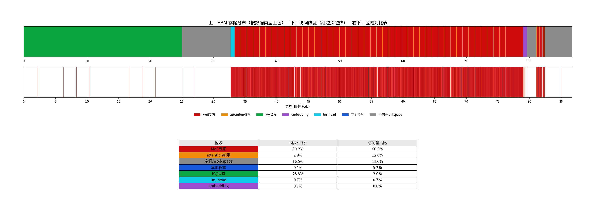

*图 5-1：上=存储分布；下=访问热度（红越深越热）。*

| 区域 | 地址占比 | 访问量占比 |
|---|---|---|
| **MoE 专家** | 50.2% | **68.5%** |
| attention 权重 | 2.9% | **12.6%** |
| 激活/workspace | 16.5% | 11.0% |
| 其他权重(norm/路由) | 0.1% | **5.2%** |
| KV/状态 | 28.8% | 2.0% |
| lm_head | 0.7% | 0.7% |
| embedding | 0.7% | ~0 |

要点：
- **权重区（尤其 MoE）访问量最大**（MoE 占约 68.5%），主要由 **TMA 搬运**；
- KV/状态区虽占 28.8% 地址，但本次只跑短上下文（19 token/请求），**实际只访问了约 0.28% 的 KV 地址**；
- "其他权重"（norm/路由门控）只占 0.1% 地址却有 5.2% 访问量——因为每个 token、每层都必读，**单位地址访问频率极高**。

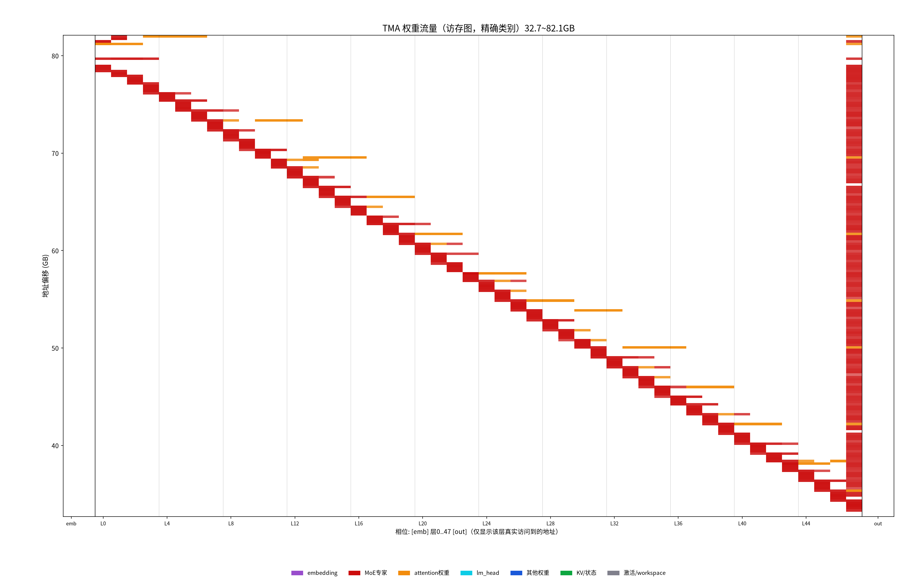

*图 5-2：仅 TMA 通道的权重流量热图——证明**权重主要经 TMA 搬运**（普通 LD/ST 抓不到，是 v4 看不到权重的原因）。*

### 5.2 每 token 的字节预算
| 每 token 读取 | 大小（全 48 层） | 内容相关? |
|---|---|---|
| attention/GDN 权重 | ~2.5GB | 否（必读） |
| shared expert | ~0.09GB | 否 |
| norm / 路由门控 | ~0.10GB | 否 |
| lm_head | ~0.62GB | 否（每 token 一次） |
| **MoE 路由专家** | ~0.85GB（10/512×48） | 是 |
| **合计** | **≈4.2GB/token** | |

- 单专家完整权重≈1.77MB；每 token 每层读 10 个专家，全层合计约 0.85GB。
- decode 基本是**带宽受限**：每 token 都要重读约 4.2GB。

### 5.3 层×地址访存热图（张量对齐、无假跨层）
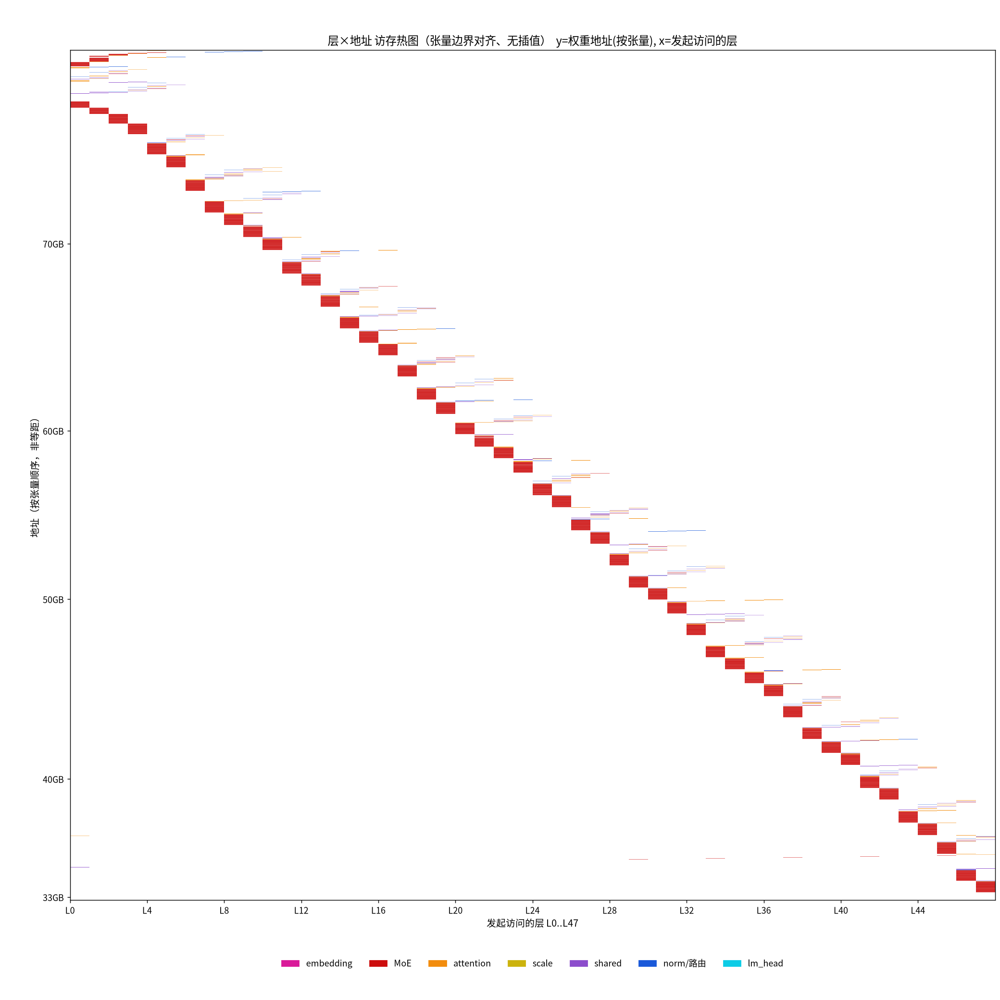

*图 5-3：x=发起访问的层，y=按张量边界对齐的地址。可见一条干净的斜向阶梯：**每层只访问自己层的权重**，无横跨多层的假色带。*

- 该图把每层的 MoE 块（红）、attention（橙）、norm/路由（蓝）等按类型着色；底色纯白、无插值。
- **跨层访问矩阵**（regular 通道）对角 ≈97.5%，非对角几乎全部是 L47 的解析假象（已剔除后归零）。图见 `v5_crosslayer_matrix.png`。

### 5.4 KV / 激活热度
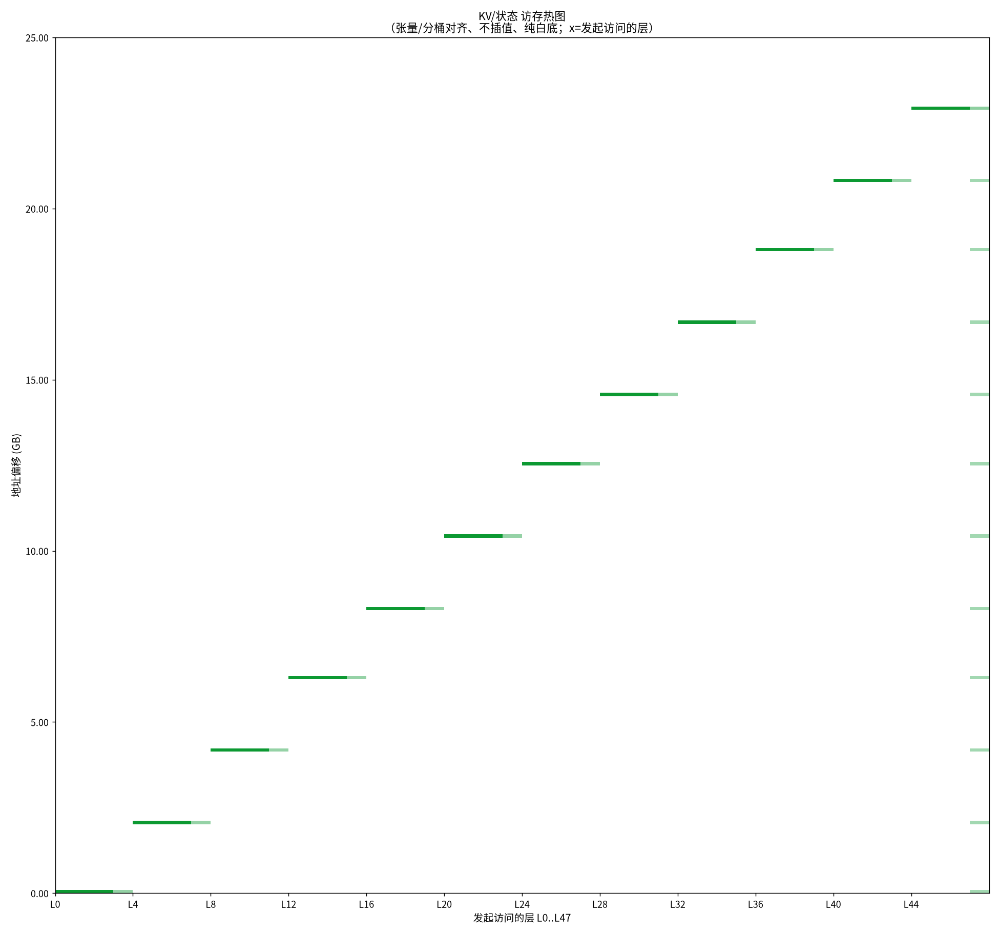

*图 5-4：KV/状态区——每层访问自己那段 KV（斜对角），短上下文下只触到很小一部分。*

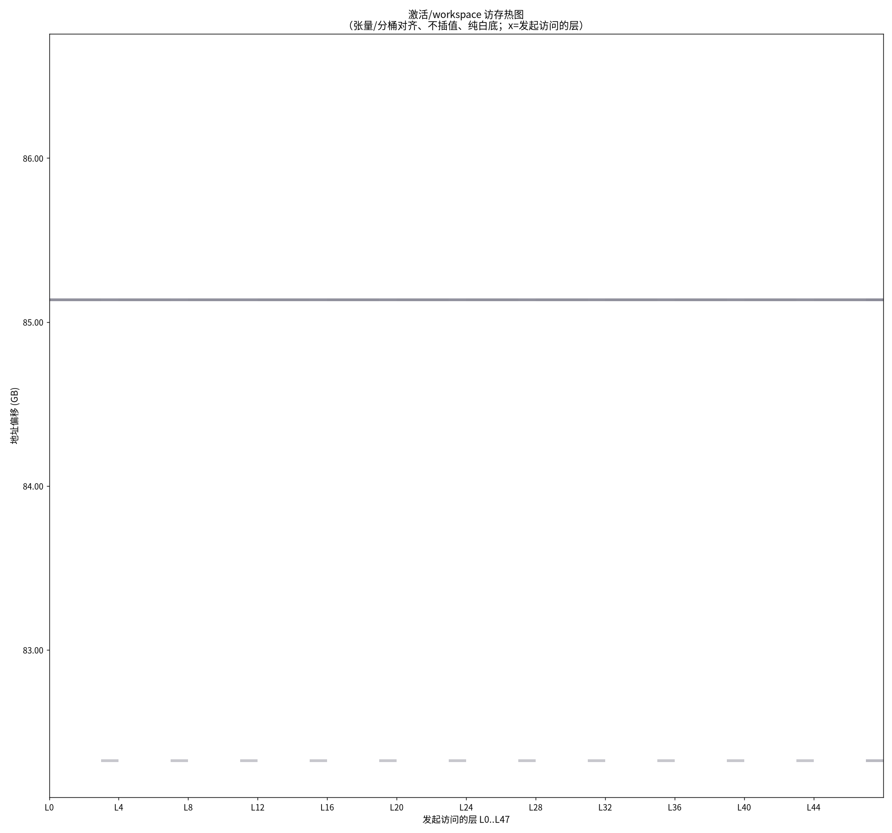

*图 5-5：激活/workspace——几乎所有层都打在同一批共享 scratch 地址（两条横线），这是多层复用同一块工作区的正常现象。*

---

## 6. 单层的算子/kernel 与访存数据类型

以 **L24（一个线性注意力 GDN + MoE 层）** 为例，一个 decode token 在该层会启动 **62 个 kernel**，按算子流水可分为五段。下表把"算子/kernel/访存数据类型"对应起来：

| 阶段 | kernel（索引） | 作用 | 读的权重类型 |
|---|---|---|---|
| 输入 RMSNorm + 量化 | [0]–[12] | RMSNorm（pow/mean/rsqrt）、拷贝、量化准备 | norm（极小） |
| GDN 线性注意力 | [13] in_proj GEMM；[14] GEMV；[23] causal_conv1d；[24] gated delta rule；[25] layer_norm；[26] 量化；[27] out_proj GEMM | 线性注意力 | **attention/GDN**（`linear_attn.*`，橙） |
| post-attn RMSNorm + 量化 | [28]–[41] | 第二个 RMSNorm、量化 | norm（极小） |
| shared expert | [42] gate_up GEMM、[43] SiLU×门、[44] 量化、[45] down GEMM、[46]dot、[47]reduce、[48]sigmoid、[49]elementwise | 稠密共享专家 + 门控 | **shared**（紫） |
| 路由 + 路由专家 MoE | [50] router GEMV；[51] topkGating；[52] 量化；[53]–[55] expert prefix-sum；[56] expand rows；[57] TMA strides；[58] grouped GEMM(w13)；[59] 激活；[60] grouped GEMM(w2)；[61] 合并 | MoE 路由与专家计算 | **路由门控**（蓝）+ **MoE 专家**（红） |

- **真正读权重的 kernel 只有少数几个**：attention 的 in_proj/conv/delta/out_proj、shared 的 gate_up/down、router、以及 MoE 的 w13/w2 grouped GEMM；其余大量 copy/elementwise/quant/prefix-sum **只碰激活/workspace**。
- **MoE 专家是"10/512"稀疏读**：每层只命中 10 个专家的地址切片，因此权重区里的红色是稀疏细条（对应专家偏移）。
- 可视化：
  - `v5_L24_kernel.png` / `v5_L25_kernel.png`：单层权重区、按 kernel 的"本层/他层"访问（相邻层权重越界=0）；
  - `v5_L24_alladdr.png` / `v5_L25_alladdr.png`：单层全部访存地址（断轴，含权重+KV+激活，按类型上色、每段单一类型）。

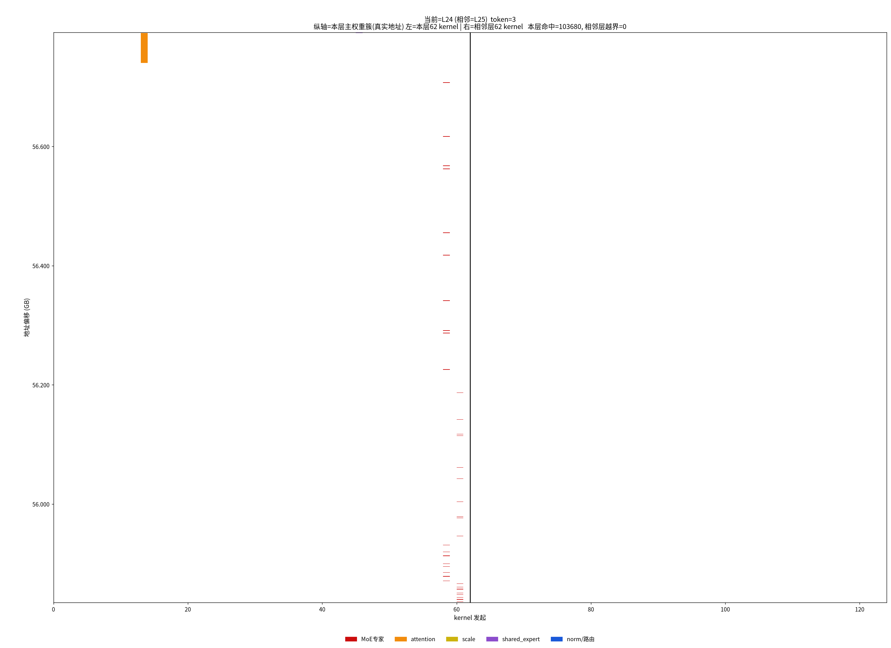

*图 6-1：L24 权重区，纵轴=本层权重地址、横轴=本层+相邻层 kernel；右侧相邻层 kernel 全空（无跨层权重访问）。*

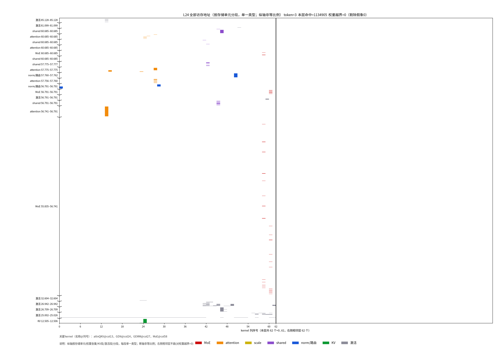

*图 6-2：L24 全部访存地址（断轴；纵轴按存储单元分段、单一类型；MoE 红线=10/512 专家）。*

---

## 7. MoE 专家激活规律与预取可行性研究

### 7.1 同一 token、相邻两层：几乎无关（不能据此预取）
统计（57 token、相邻层对）：平均交集 **0.20/10**，平均 Jaccard **0.0104**，随机基线 **0.0099** → **相邻层选中的专家≈随机**。故"用第 k 层专家偏移去预取第 k+1 层"命中率≈2%，不可行。

### 7.2 相邻 token、同一层：显著相关（可跨 token 缓存/预取）
统计：平均交集 **4.46/10**，平均 Jaccard **0.3136**（p90≈0.54，最大 1.0）→ **相邻 token 在同一层平均共享 4~5 个专家**，远高于随机。原因：相邻 decode 步 hidden 接近、同层 router 选出相近专家。

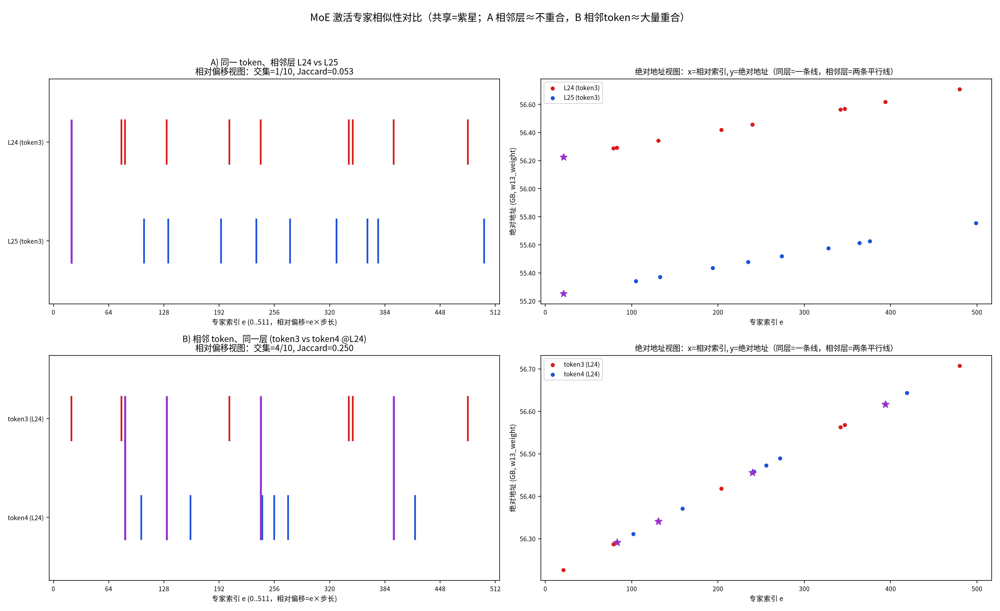

*图 7-1：左=相对偏移条带（上 A：同 token 相邻层；下 B：相邻 token 同层）；右=绝对地址散点（x=专家索引、y=GB）。A 几乎不重合（1/10），B 大量重合（4/10）。*

**预取含义**：
- **确定性权重（attention/GDN + shared + norm/router + lm_head，约 3.3GB/token）**：地址固定、每 token 必读 → **可逐层预取/双缓冲**，收益最大、最稳。
- **MoE 专家**：不可用"相邻层"预测；但可用**跨 token 复用**——生成 token t+1 时，token t 每层的专家已知，可提前预取（预计命中~45%），或用"最近 k 个 token 并集/热点专家缓存"提高命中。

### 7.3 专家热度（跨 token，同层）
对单个 prompt 的 19 个 token 统计每层每个专家被选中的次数（0..19），可区分"热专家"与"冷专家"：

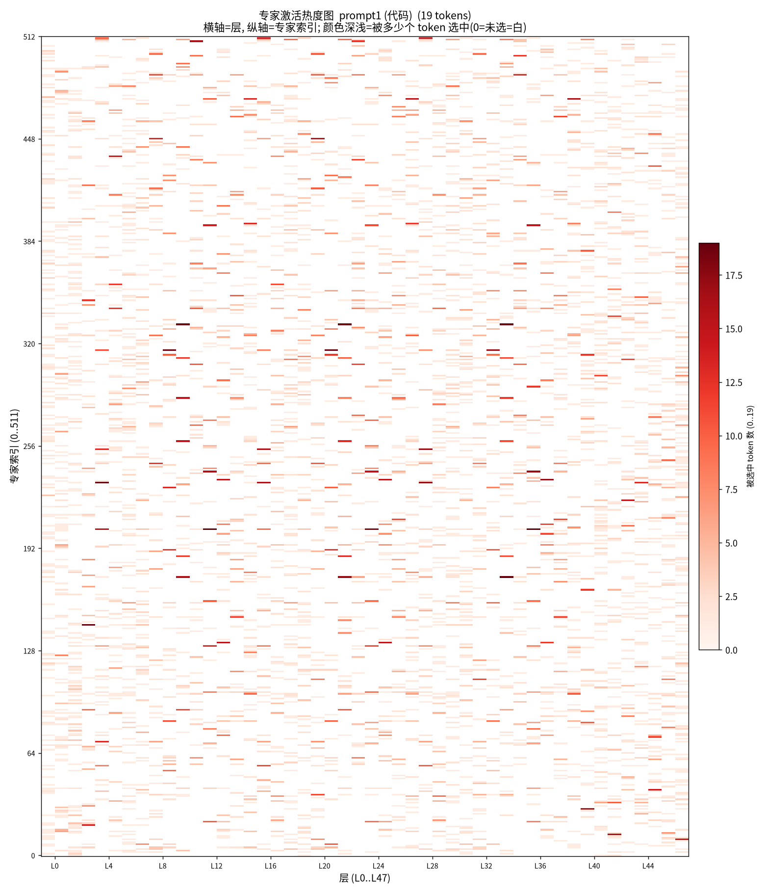

*图 7-2：prompt1 的专家激活热度（prompt2/3 与三合一另见 `v5_expert_heat_p2.png`、`v5_expert_heat_p3.png`、`v5_expert_heat_all.png`）。*

- 单 prompt（19 个高度相关的 token）每层平均只触及约 **77 个不同专家**（512−435 冷专家），少数专家被反复选中（深红=热）；合并 57 token 后覆盖更广（冷专家降到约 348）。
- 专家热度高度偏斜（此前统计：每层 top-64 专家覆盖约 85–90% 的激活量，远高于均匀的 12.5%）→ **热点专家缓存**是有效方向。

### 7.4 相邻 token 同层相似性随层分布
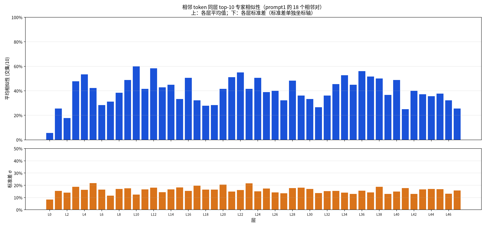

*图 7-3：上=每层相邻 token 相似性（交集/10）的平均值（蓝）；下=其标准差（橙，独立坐标轴）。prompt1 的 18 个相邻对，总体均值≈40%，L0 特别低（~6%）。*

- 相似性随层变化（多数层 30%~60%），标准差另置下半区表示"相邻对之间的波动"。

---

## 8. 从 trace 到 FPGA 仿真激励（纯流量激励 + bank/row 时序）

### 8.1 目标与前提
- FPGA 用 MB 级 SRAM 模拟 HBM；输入为**纯流量激励（数据无关）**：地址 + 读写 + 大小 + 到达节奏；数据内容不要求真实。
- 目标存储模型为**完整 bank/row 时序**：模拟行缓冲、行命中/冲突、时序参数，以评估带宽/延迟及预取效果。

### 8.2 第一步：提取"访存特性指纹"
**指纹 = 从 trace 总结出的行为画像**（每层、每类操作：读写什么类型、一次搬多大、整块还是分散、读写、并发、落哪些 bank/row）。提取方法：
1. **分桶**：按"层 + 阶段 + 算子类型"分组；
2. **逐条贴标签**：谁在读、读什么（查 allocator_map）、多大、读/写；
3. **每桶统计**：请求大小分布、连续 run 长度、空间散度（如 MoE 10/512）、读写比、复用距离、并发度、地址→bank/row 分布、每层字节预算。

示例（L24）：
```jsonc
{ "type":"moe",  "read_bytes":17.7e6, "n_bursts":10, "burst_bytes":1.77e6, "spatial":"512槽散选10", "rw":"read" }
{ "type":"attn", "read_bytes":55.4e6, "contiguity":"整块连续", "rw":"read" }
{ "type":"lmhead","read_bytes":0.62e9, "contiguity":"整块连续", "rw":"read" }
```

### 8.3 第二步：地址/容量抽象（统计等价映射）
- 定义模拟 DRAM 几何 `channels×banks×rows×cols×burst`，总容量=SRAM。
- **保留真实**：row/page 大小、burst 粒度、**全部时序参数**（tRCD/tRP/tRAS/tRC…，按 HBM 手册真实 ns）；
- **按容量缩小**：bank 数、row 数（保证 bank 数足够体现并行）。
- 对真实地址用真实 HBM 解码规则得到 `(channel,bank,row,col)`，再**重映射**到缩小几何（模/哈希），**校准到 bank 负载分布与行命中率**与真实统计一致。即"统计等价"，不追求逐地址相同。

### 8.4 第三步：激励生成
三种方案，推荐 **结构模板(C) + 统计生成器(A)**：
- **A 统计生成器**：按每桶的 size/run/读写/落点分布采样生成；输入极小、可实时生成。
- **B 精简回放/地址折叠**：抽样或折叠真实 trace，时序最真但体积大/需校准。
- **C 结构化模型感知**：用"层/算子模板"复刻序列，专家路由按分布、KV 按上下文增长建模。

注意：
- **不能"几千~上万请求循环"**：一个 decode token ≈4.2GB 访存（128B 事务≈3300万、1KB burst≈420万）；且每轮专家应随机重采样（含热点偏斜），循环固定序列会高估行命中、低估地址散布。
- **必须建模并发与到达节奏**（在途请求窗口、多 bank 并行、控制器重排），不能串行逐条发。

### 8.5 完整 bank/row 时序模型的落地
- SRAM 组织为 `banks×rows×row_size`；每 bank 维护 **open-row 标签 + 真实时序计时器**。
- 请求处理：解码 `(bank,row,col)`；命中当前行→行命中（快）；否则 precharge+activate（行冲突）→ 该 bank 期间不可服务其它行（bank 冲突）。
- 控制器维护各 bank 队列、可重排（合并行命中、分散到不同 bank）。
- 局限：现有 trace **无时间戳**，精确到达时序需补采带 cycle 的 trace；否则用"字节/带宽"近似。

### 8.6 验证指标（校准闭环）
行命中率、bank 冲突率、每 bank 负载、平均/尾部延迟、带宽、请求大小分布、读写比。生成 → 跑 FPGA 模型 → 对比 trace 目标 → 调重映射/并发/粒度。

### 8.7 第一步可交付
- `traffic_profile.py`：输出每 `(layer, kernel-type)` 的**指纹 JSON**；
- `stim_gen.py`：读指纹 + DRAM 几何 → 生成激励流（描述符/RNG 或二进制），并自带与指纹目标的对比报告。

---

## 9. 主要结论

1. **权重访问由 TMA 主导**，MoE 专家占访问量约 68.5%；旧工具漏抓 TMA 是 v4 看不到权重的原因。
2. **每 token 只激活 10/512 专家**；单层 MoE 块约 906MB，单专家约 1.77MB；中间 43 层布局统一，L0–L4 例外。
3. **各层只访问自己的权重**（张量对齐后对角≈100%），所谓"跨层拖尾"是粗分桶/插值/解析假象。
4. **相邻层专家≈随机**（不可据此预取）；**相邻 token 同层专家强相关**（≈4~5/10，Jaccard≈0.31）→ 跨 token 缓存/预取可行。
5. **确定性权重（attention/GDN/shared/norm/router/lm_head，约 3.3GB/token）可逐层预取**，是计算-IO 掩盖的主要收益来源；MoE 专家（0.85GB/token）需预测/热点缓存。
6. decode 为**带宽受限**；每 token 约 4.2GB 读取，KV 在短上下文下访问极少。
7. 已形成"**trace → 特性指纹 → 统计等价激励 → bank/row 时序模型**"的 FPGA 输入转化路线。

---

## 10. 局限与后续工作
- 仅采集 **decode**，且只有 **57 token（3 prompt × 19）**；样本偏小，"冷专家"仅代表本样本。
- 一次采集尾部被杀（TMA 尾部少量未 flush）；TMA 在 L47 有解析假象（已后处理剔除，根修需改工具并重采）。
- trace **无时间戳**：要做精确到达时序/并发仿真，需补采带 cycle 的 trace。
- 建议补采：**长上下文（512/2K/4K）**以体现 KV 增长；更多 token 以稳定专家热度/并集；必要时 prefill。

---

## 附录：主要图表与脚本
**图**：`v5_storage_1d.png`、`v5_storage_1d_zoom.png`、`v5_heat_1d.png`、`v5_heat_vs_storage.png`、`v5_tma_weights.png`、`v5_layers_aligned_clean.png`、`v5_crosslayer_matrix.png`、`v5_KV_aligned.png`、`v5_act_aligned.png`、`v5_L24_kernel.png`、`v5_L25_kernel.png`、`v5_L24_alladdr.png`、`v5_L25_alladdr.png`、`v5_expert_similarity.png`、`v5_expert_heat_p1/p2/p3/all.png`、`v5_adjacent_similarity_bar.png`。

**脚本**：`analyze_v5b.py`、`analyze_aligned2.py`、`plot_v5.py`、`plot_aligned_clean.py`、`plot_broken2.py`、`plot_kvact.py`、`plot_expert_sim.py`、`plot_expert_heat.py`、`plot_adj2.py`。
