# Qwen3-Next-80B-A3B decode 阶段 HBM 访存特性分析总结（v2）

> 本文围绕"为大模型 decode 阶段构建 FPGA 硬件仿真激励"这一目标，系统总结对 Qwen3-Next-80B-A3B 的 HBM 访存 trace 的分析结果。全文分三章：**前言背景**、**数据分析**、**FPGA 硬件仿真平台落地方案**。

---

# 第一章　前言背景

## 1.1 为什么采集 trace

目标是为一个 **FPGA 硬件仿真平台**（Host FPGA → HBM FPGA）提供**真实工作负载的访存激励**。该平台用 **MB 级 SRAM 模拟 HBM**，用于评估大模型 decode 阶段的存储行为（带宽、延迟、bank/row 冲突）以及预取、双缓冲等"计算-IO 掩盖"策略。

由于 FPGA 片上容量只有 MB 级，而模型所需的 HBM 地址空间是 80GB 级，**无法把真实 trace 原样作为输入**。合理的路径是：

> 采集真实 decode 的 HBM 访存 trace → 归纳其**访存规律** → 抽象成**访存特性指纹** → 生成**统计等价、容量适配**的激励。

因此，本文的落脚点是"**理解并量化 decode 的访存特性**"，为后续激励生成提供依据。

## 1.2 采集对象与方法

- **模型**：Qwen3-Next-80B-A3B-Instruct（NVFP4 量化）。48 层；MoE 每层 512 个 routed 专家、每 token 激活 top-10；每层另有 1 个 shared expert；混合注意力——每 4 层中 3 层为线性注意力(GDN)、1 层为全注意力（全注意力在 L3/7/…/47，共 12 层）。
- **平台**：RTX 6000D（sm_120，96GB），CUDA 13.0，vLLM 0.33，`enforce_eager=True`，batch=1。
- **采集工具**：基于 NVBit 的工具，同时采集两类通道：
  - **普通 LD/ST**（LDG/STG 等线程级访存）：记录 `grid, cta, warp, opcode, 地址, 大小, layer_id`；
  - **TMA**（`cp.async.bulk.tensor`，CUTLASS 用于批量搬运权重/激活）：逐 tile 记录 `起始地址, 跨度, 元素数, layer_id`。
- **相位标记**：每层 forward 前打 marker，使 record 带上相位：`100=embedding, 0–47=层, 200=output(lm_head)`。
- **采集范围**：仅采集 **decode**（`seq_len==1` 时开启）。3 个不同 prompt（代码 / 数学 / 中文闲聊），各 19 个 decode token，共 **57 个 token**。
- **allocator 地图**：与 trace **同一次运行**内导出，记录每个权重张量的名字/地址/大小，以及 KV/状态池区间，用于把地址映射到"数据类型 / 所属层"。

## 1.3 数据规模与说明

- 普通 LD/ST：约 **41.87 亿条**；TMA：约 **2986 万条**；权重 **47.42GB**，KV/状态池 **25GB**。
- 本次采集为一次运行；TMA 通道尾部有极少量未落盘。
- **未采集 prefill**（其访存特性与 decode 不同，见 §2.3.4）。
- trace **不含时间戳**，精确到达时序需后续补充。

---

# 第二章　数据分析

## 2.0 本章概览

本章基于上述 trace，围绕四个递进的问题展开：

1. **存储分布**：模型的各类数据在 HBM 上"存在哪里、怎么排布"（尤其 MoE 的组织方式）；
2. **访问频率分布**：这些地址"被访问得多不多、热点在哪"；
3. **单层访存流程**：一个 token 经过一层时"有哪些算子/kernel、各自访存什么数据"（decode 与 prefill）；
4. **预取规律**：单 token 跨层、以及多 token 同层时，激活的 MoE 专家"是否可预测"，据此判断预取/缓存的可行性。

递进关系为：**先"东西在哪"(1) → 再"谁热"(2) → 再"每层怎么用"(3) → 最后"能否预测利用"(4)**。

**分析口径**（本章所有图与统计均采用）：
- **逐记录精确归属**：每条访存用其精确地址在"张量区间表"中二分，确定唯一所属张量（→ 精确数据类型与层）；
- **张量边界对齐的纵轴**：地址轴按张量边界切分，每一行只属于唯一张量，小张量至少保留 1 行；
- **分类上色、不插值**：按数据类型着色，纯白底；
- 对不可信的解析记录（见 §2.1 末）予以剔除。

---

## 2.1 全量模型的访存存储分布

### 2.1.1 各类数据的总体占比
按地址长度统计整块 HBM（0~86GB）：

| 区域 | 地址占比 | 大小/说明 |
|---|---|---|
| **MoE 专家** | **50.2%** | 43.5GB，权重主体 |
| **KV/状态** | **28.8%** | 25.0GB 池 |
| 空洞/未分配 | 16.5% | 对齐空隙 + 1.48GB 大洞（运行时作 workspace） |
| attention 权重 | 2.9% | 2.5GB |
| embedding | 0.7% | 0.62GB |
| lm_head | 0.7% | 0.62GB |
| 其他权重 | 0.1% | norm、路由门控等 |

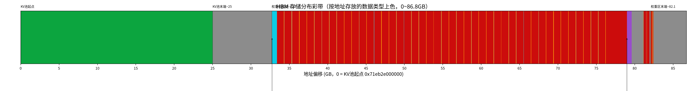

*图 2-1　HBM 存储分布彩带：按地址存放的数据类型上色。*

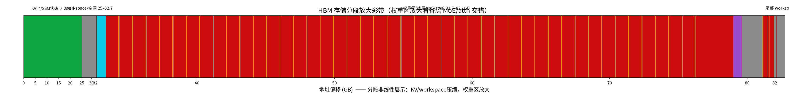

*图 2-2　分段非线性放大：KV/workspace 压缩、权重区放大，便于看清各层 MoE 与 attention 的交错。*

### 2.1.2 层与 MoE 的组织方式
- 各层权重整体呈**按层倒序**排布（高层在低地址、低层在高地址），每层权重相对集中在各自的地址带内。
- **每层 MoE（routed experts）由 4 个大张量连续组成**，合计约 **906MB**。以中间层为例：

| 相对该层 MoE 块起点 | 大小 | 张量 | 每专家步长 |
|---|---|---|---|
| 0.00 MB | 33.55MB | `w2_weight_scale` | 0.0655 MB |
| 33.55 MB | 67.11MB | `w13_weight_scale` | 0.1311 MB |
| 100.66 MB | 268.44MB | `w2_weight`（down） | 0.5243 MB |
| 369.10 MB | 536.87MB | `w13_weight`（gate+up） | 1.0486 MB |

要点：
- 4 个张量的第 0 维都是 **512（专家数）**，专家**按索引 0..511 连续存放**；专家 e 在张量 t 内的偏移 = `e × 步长_t`。
- **一个完整专家**跨上述 4 个张量，合计 **≈1.77MB**（另有 `[512]` 的极小量化标量）。
- **布局一致性**：中间 **43 层**布局统一（同表）；**L0–L4 例外**（受 embedding/lm_head 影响被劈开、打散），地址计算需单独处理。

### 2.1.3 数据可信性处理
TMA 地址在 **L47 少数 grouped-GEMM** 上会解析出"均匀撒向各层"的异常地址。由于"某层 kernel 访问别层权重"在物理上不应发生，本文将这些"record 所属层 L、却命中别层权重地址"的记录判为解析异常并**剔除**（仅影响 L47），以保证统计与作图可信。

---

## 2.2 全量模型的访存频率分布

### 2.2.1 访问热度与存储分布对照
热度 = 每个地址被访问的量（普通记录数 + TMA 元素数，取对数）。

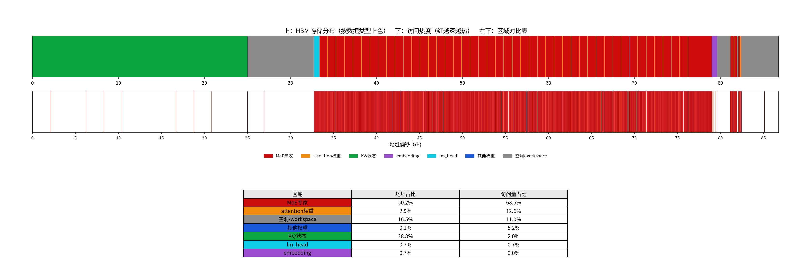

*图 2-3　上：存储分布；下：访问热度（红越深越热）。*

| 区域 | 地址占比 | **访问量占比** |
|---|---|---|
| **MoE 专家** | 50.2% | **68.5%** |
| attention 权重 | 2.9% | **12.6%** |
| 激活/workspace | 16.5% | 11.0% |
| 其他权重(norm/路由) | 0.1% | **5.2%** |
| KV/状态 | 28.8% | 2.0% |
| lm_head | 0.7% | 0.7% |
| embedding | 0.7% | ~0 |

观察：
- **权重（尤其 MoE）是访问主体**，MoE 约占访问量的 68.5%，主要由 **TMA** 搬运；
- **KV 区地址占比高，但本次只跑短上下文，实际访问极少**（约 0.28% 的 KV 地址）；
- **norm/路由门控只占 0.1% 地址却有 5.2% 访问量**——每 token、每层必读，单位地址访问频率极高。

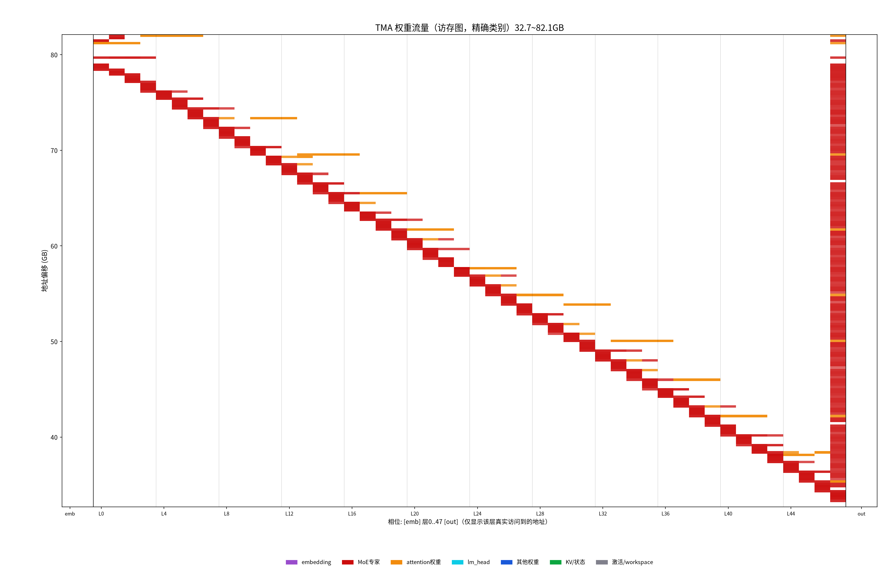

*图 2-4　仅 TMA 通道的权重流量：权重主要由 TMA 搬运。*

### 2.2.2 每 token 的读取预算
| 每 token 读取 | 大小（全 48 层） | 内容相关? |
|---|---|---|
| attention/GDN 权重 | ~2.5GB | 否（必读） |
| shared expert | ~0.09GB | 否 |
| norm / 路由门控 | ~0.10GB | 否 |
| lm_head | ~0.62GB | 否（每 token 一次） |
| **MoE 路由专家** | ~0.85GB（10/512×48） | 是 |
| **合计** | **≈4.2GB/token** | |

结论：decode 基本是**带宽受限**——每生成一个 token 都要重读约 4.2GB 权重。

### 2.2.3 层×地址访问热图
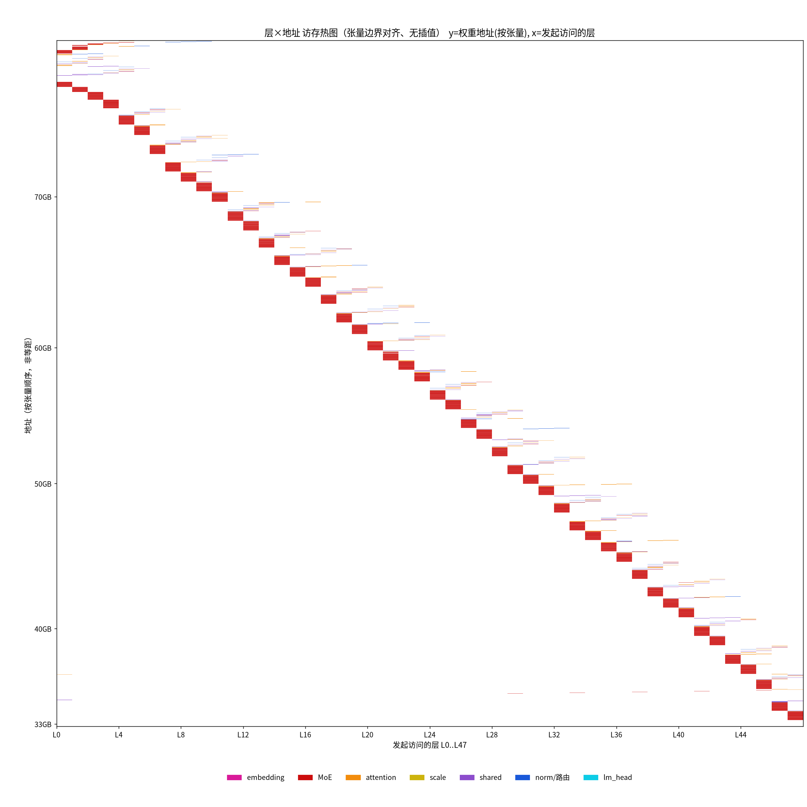

*图 2-5　x=发起访问的层，y=按张量边界对齐的地址。呈现干净的斜向阶梯：**每层只访问自己层的权重**。*

- 跨层访问矩阵（普通通道）对角约 **97.5%**，即各层只读自己的权重，层间不存在真实的权重互访。
- KV/激活热度见下图：KV 每层访问各自那段（斜对角，短上下文只触到很小一部分）；激活/workspace 各层复用同一批共享 scratch（呈固定地址横线）。

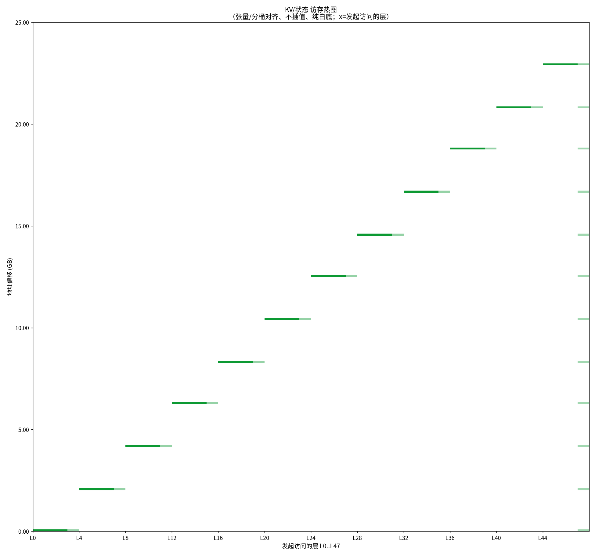

*图 2-6　KV/状态区访存热图。*

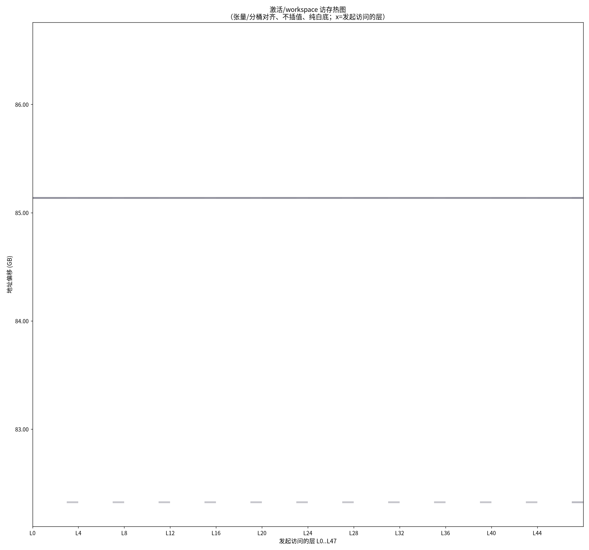

*图 2-7　激活/workspace 访存热图（各层复用同一批 scratch，属正常现象）。*

---

## 2.3 单层模型的访存流程

本节把"一个 token 经过一层"的算子/kernel 流程，与"各 kernel 访问什么数据"对应起来，并给出 decode 与 prefill 的流程。

### 2.3.1 decode 的层内算子流程
decode 每步处理 1 个 token，过 48 层；每层顺序为：

```
input_layernorm → 注意力块(GDN 或全注意力) → 残差
              → post_attention_layernorm → MoE(router→top10 专家 + shared) → 残差
```

以 **L24（线性注意力 GDN + MoE）** 为例，一个 decode token 在该层会启动 **62 个 kernel**，按算子分组如下：

| 阶段 | kernel（索引） | 作用 | 访问的权重类型 |
|---|---|---|---|
| 输入 RMSNorm + 量化 | [0]–[12] | RMSNorm（pow/mean/rsqrt）、拷贝、量化 | norm（极小） |
| GDN 线性注意力 | [13] in_proj GEMM；[14] GEMV；[23] causal_conv1d；[24] gated delta rule；[25] layer_norm；[26] 量化；[27] out_proj GEMM | 线性注意力 | **attention/GDN**（橙） |
| post-attn RMSNorm + 量化 | [28]–[41] | 第二个 RMSNorm、量化 | norm（极小） |
| shared expert | [42] gate_up、[43] SiLU×门、[44] 量化、[45] down、[46] dot、[47] reduce、[48] sigmoid、[49] 合并 | 稠密共享专家 + 门控 | **shared**（紫） |
| 路由 + 路由专家 MoE | [50] router GEMV；[51] topk；[52] 量化；[53]–[55] prefix-sum；[56] expand rows；[57] TMA strides；[58] grouped GEMM(w13)；[59] 激活；[60] grouped GEMM(w2)；[61] 合并 | MoE 路由与专家计算 | **路由门控**（蓝）+ **MoE 专家**（红） |

- **真正读权重的 kernel 只有少数几个**：attention 的 in_proj/conv/delta/out_proj、shared 的 gate_up/down、router、MoE 的 w13/w2 grouped GEMM；其余大量 copy/elementwise/quant/prefix-sum **只读写激活**。
- **MoE 专家是"10/512"稀疏读**：每层只命中 10 个专家的地址切片，因此权重区里表现为稀疏细条。

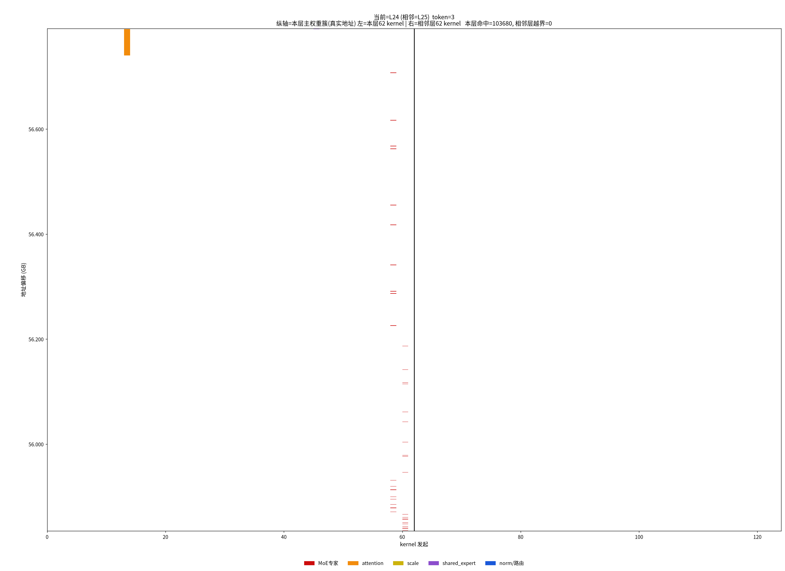

*图 2-8　L24 权重区，按 kernel 展示"本层/他层"访问；右侧相邻层 kernel 全空（无跨层权重访问）。*

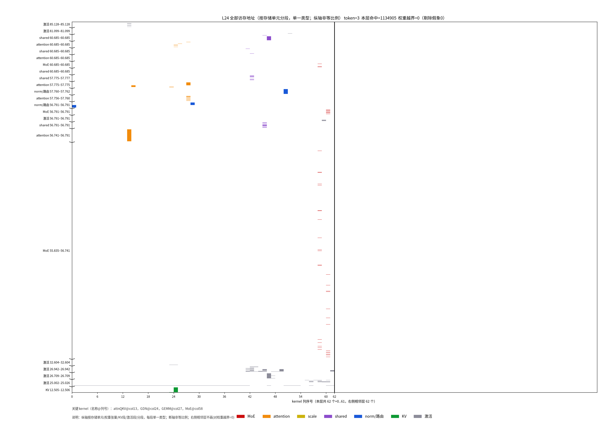

*图 2-9　L24 全部访存地址（断轴；纵轴按存储单元分段、单一类型；MoE 红线对应 10/512 专家）。*

### 2.3.2 访存数据类型的对应关系
综合起来，层内的访存与数据类型一一对应：
- **MoE（红）**=routed 专家 w13/w2/scale，稀疏读（top-10）；
- **attention/GDN（橙）**=in_proj/conv/A_log/dt_bias/out_proj 等，每 token 必读；
- **shared（紫）**=shared_expert 的 gate_up/down；
- **norm/路由（蓝）**=两层 LayerNorm + `mlp.gate`；
- **激活/workspace（灰）**=各类 copy/elementwise/量化/前缀和等临时缓冲。

### 2.3.3 prefill 阶段流程（对照）
prefill 把整段 prompt 的 N 个 token **一次并行**过 48 层：
- 注意力为 `N×N` 的**因果自注意力**（token i 只看到 j≤i），Q/K/V 为 N 行；
- 每层把 N 个 prompt token 的 K/V **一次写满** KV cache；
- 第 47 层后得到 `logits (N×V)`，**只用最后一个位置的 logits** 采样出第一个生成 token；其余位置 logits 生成时不用。

### 2.3.4 decode 与 prefill 的对比
| | prefill | decode |
|---|---|---|
| 输入 | N token 一起 | 1 token |
| 注意力形状 | N×(cache+N)，含 N×N 因果块 | 1×(cache+1) |
| 瓶颈 | 计算密集（大 GEMM） | 访存密集（重读权重、读长 KV） |
| KV | 批量写入 | 每步追加 1 个 |
| 本次采集 | 否 | 是 |

---

## 2.4 MoE 专家激活规律与预取分析

基于"确定性权重必读、MoE 专家按内容选择"的认识，本节研究专家激活的可预测性：**单 token 多层** vs **多 token 单层**。

### 2.4.1 单 token、相邻两层：几乎无关
统计（57 token、全部相邻层对）：相邻两层 top-10 专家的平均交集 **0.20/10**，平均 Jaccard **0.0104**，与随机基线（0.0099）几乎相同。
→ **相邻层选中的专家近似随机**，不能用"上一层专家偏移"去预测/预取下一层。

### 2.4.2 相邻 token、同一层：显著相关
统计：相邻 token 在同一层的平均交集 **4.46/10**，平均 Jaccard **0.3136**（p90≈0.54，最大 1.0）。
→ **相邻 token 同层平均共享 4~5 个专家**，显著高于随机。原因：相邻 decode 步的 hidden 接近，同层 router 选出相近专家。

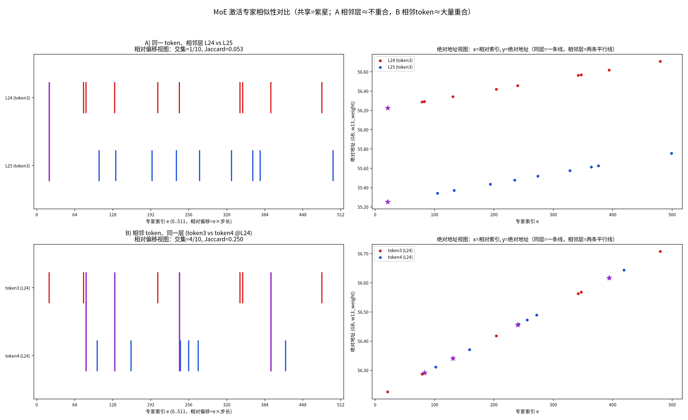

*图 2-10　左：相对偏移条带（上=同 token 相邻层，几乎不重合；下=相邻 token 同层，大量重合）；右：绝对地址散点（x=专家索引、y=GB；同层为一条线、相邻层为两条平行线）。*

### 2.4.3 专家热度与相邻 token 相似性
- **专家热度**（单 prompt 19 token，每层每个专家被选中的次数）：

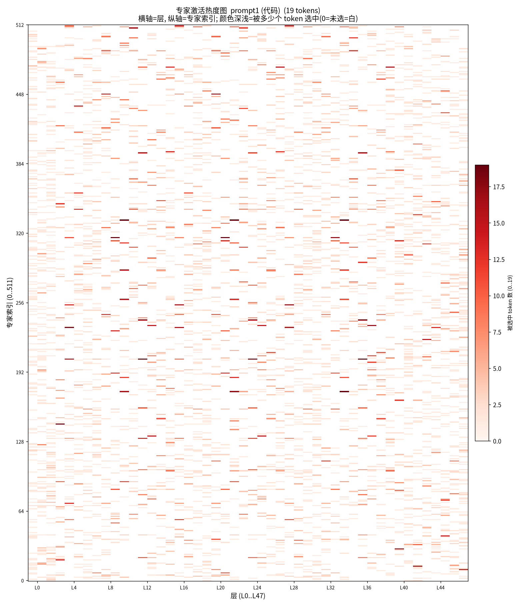

*图 2-11　prompt1 专家激活热度（另见 prompt2/3 与三合一的 `v5_expert_heat_p2/p3/all.png`）。*

  - 单 prompt（19 个高度相关 token）每层平均只触及约 **77 个不同专家**（其余为白/冷），少数专家被反复选中（深红=热）；合并 57 token 后覆盖更广。
  - 专家热度高度偏斜：每层 top-64 专家覆盖约 **85–90%** 的激活量（均匀仅 12.5%）。

- **相邻 token 同层相似性随层分布**：

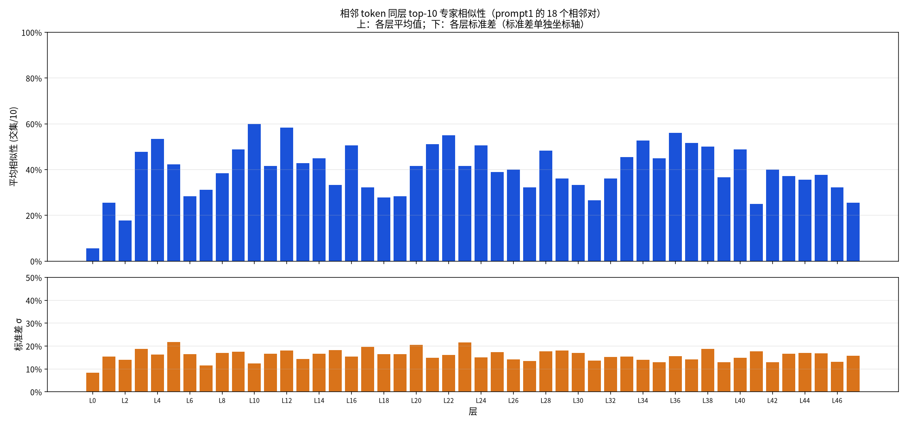

*图 2-12　上：各层相邻 token 相似性均值（蓝，prompt1 的 18 个相邻对，总体≈40%）；下：其标准差（橙，独立坐标轴）。*

### 2.4.4 对预取的启示
- **确定性权重**（attention/GDN + shared + norm/router + lm_head，约 3.3GB/token）：地址固定、每 token 必读 → **可逐层预取/双缓冲**，收益最大、最稳。
- **MoE 专家**（约 0.85GB/token）：
  - 不能用"相邻层"预测；
  - 但**相邻 token 同层强相关**（共享 4~5/10），且**热点专家偏斜** → 可做**跨 token 专家缓存/预取**（复用上一 token 各层用过的专家，或缓存热专家）。

---

# 第三章　FPGA 硬件仿真平台落地方案

## 3.1 目标与形态
- FPGA 用 **MB 级 SRAM 模拟 HBM**；输入为**纯流量激励（数据无关）**：地址 + 读写 + 大小 + 到达节奏。
- 目标存储模型为**完整 bank/row 时序**：模拟行缓冲、行命中/冲突与时序参数，用于评估带宽、延迟与预取效果。

## 3.2 第一步：提取"访存特性指纹"
**指纹 = 从 trace 归纳出的行为画像**（每层、每类操作：读写什么类型、一次搬多大、整块还是分散、读写、并发、落哪些 bank/row）。方法：
1. **分桶**：按"层 + 阶段 + 算子类型"分组；
2. **逐条贴标签**：谁在读、读什么（查 allocator 地图）、多大、读/写；
3. **每桶统计**：请求大小分布、连续 run 长度、空间散度（如 MoE 10/512）、读写比、复用距离、并发度、地址→bank/row 分布、每层字节预算。

示例（L24）：
```jsonc
{ "type":"moe",   "read_bytes":17.7e6, "n_bursts":10, "burst_bytes":1.77e6, "spatial":"512槽散选10", "rw":"read" }
{ "type":"attn",  "read_bytes":55.4e6, "contiguity":"整块连续", "rw":"read" }
{ "type":"lmhead","read_bytes":0.62e9, "contiguity":"整块连续", "rw":"read" }
```

## 3.3 第二步：地址/容量抽象（统计等价映射）
- 定义模拟 DRAM 几何 `channels×banks×rows×cols×burst`，总容量 = SRAM。
- **保留真实**：row/page 大小、burst 粒度、**全部时序参数**（tRCD/tRP/tRAS/tRC…，按 HBM 手册真实 ns）。
- **按容量缩小**：bank 数、row 数（保证 bank 数足够体现并行）。
- 对真实地址用真实 HBM 解码规则得到 `(channel,bank,row,col)`，再**重映射**到缩小几何（模/哈希），校准到 **bank 负载与行命中率**与真实统计一致（统计等价，而非逐地址相同）。

## 3.4 第三步：激励生成
三种方案，推荐 **结构模板(C) + 统计生成器(A)**：
- **A 统计生成器**：按每桶的 size/run/读写/落点分布采样生成；输入极小、可实时生成。
- **B 精简回放/地址折叠**：抽样或折叠真实 trace；时序最真、体积大、需校准。
- **C 结构化模型感知**：以"层/算子模板"复刻序列，专家路由按分布、KV 按上下文增长建模。

要点：
- **不能"固定请求循环"**：一个 decode token ≈4.2GB 访存（128B 事务≈3300万、1KB burst≈420万）；每轮专家应**随机重采样**（含热点偏斜），循环固定序列会高估行命中、低估地址散布。
- **必须建模并发与到达节奏**（在途请求窗口、多 bank 并行、控制器重排），不能串行逐条发。

## 3.5 完整 bank/row 时序模型
- SRAM 组织为 `banks×rows×row_size`；每 bank 维护 **open-row 标签 + 真实时序计时器**。
- 请求处理：解码 `(bank,row,col)`；命中当前行→行命中（快）；否则 precharge+activate（行冲突）→ 该 bank 期间不可服务其它行（bank 冲突）。
- 控制器维护各 bank 队列并可重排（合并行命中、分散到不同 bank）。
- 局限：trace **无时间戳**，精确到达时序需补采带 cycle 的 trace；否则用"字节/带宽"近似。

## 3.6 验证与交付
- **验证指标**：行命中率、bank 冲突率、每 bank 负载、平均/尾部延迟、带宽、请求大小分布、读写比。生成→跑 FPGA 模型→对比指纹目标→调重映射/并发/粒度。
- **第一步交付物**：
  - `traffic_profile.py`：输出每 `(layer, kernel-type)` 的**指纹 JSON**；
  - `stim_gen.py`：读指纹 + DRAM 几何 → 生成激励流（描述符/RNG 或二进制），并自带与指纹目标的对比报告。

---

# 结语
本文以 v5 trace 为基础，从**存储分布 → 访问热度 → 单层流程 → 专家预取规律**逐层递进地刻画了 decode 阶段的 HBM 访存特性，并给出了"**指纹提取 → 统计等价映射 → 激励生成 → bank/row 时序模型**"的 FPGA 落地路线。后续可补充长上下文与带时间戳的 trace，以完善 KV 增长与到达时序的刻画。
